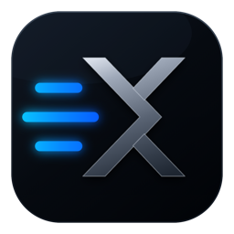

<p align="center">
  
</p>

<h1 align="center">Timeline X Studio for Claude Code, Codex, Antigravity, Cursor &amp; Muse Code</h1>

<p align="center">
  Edit and verify Timeline X Studio projects from Claude Code, Codex, Antigravity, Cursor or Muse Code through the hosted Timeline X MCP connection and managed workflow skills.
</p>

<p align="center">
  <a href="https://timelinex.studio">Website</a> ·
  <a href="#install">Install</a> ·
  <a href="#what-you-can-do">Skills</a> ·
  <a href="#privacy-and-data">Privacy</a> ·
  <a href="#troubleshooting">Troubleshooting</a> ·
  <a href="#türkçe">Türkçe</a>
</p>

<p align="center">
  
  
  
  
  
  
  
</p>

---

Talk to Claude, Codex, Antigravity, Cursor or Muse Code and let it edit your **Timeline X Studio** projects for you: cut and trim clips,
write and place captions, generate voiceover, music, images and video, build motion graphics, color
grade, and export — while every change goes through the desktop app's own undo history and checks.

## Requirements

- **Timeline X Studio** desktop app (macOS Apple Silicon or Windows x64), installed and running — get it from the [download page](https://timelinex.studio/download).
- A Timeline X Studio account (you sign in once in the browser).
- [Claude Code](https://claude.com/claude-code), [Codex CLI](https://github.com/openai/codex) [Antigravity](https://antigravity.google), [Cursor](https://cursor.com) or [Muse Code](https://dev.meta.ai/docs/muse-code).

Nothing else is installed on your machine: the plugin contains instructions (skills) and a link to
the hosted Timeline X connection. No local binaries, no API keys.

## Install

### Claude Code

```text
/plugin marketplace add kamileecher/timeline-x-plugin
/plugin install timeline-x-studio@timeline-x
```

Then run `/mcp`, choose **plugin:timeline-x-studio:timeline-x** and select **Authenticate**.

### Codex

```bash
codex plugin marketplace add kamileecher/timeline-x-plugin
codex plugin add timeline-x-studio@timeline-x
codex mcp login timeline-x
```

### Antigravity

```bash
agy plugin install https://github.com/kamileecher/timeline-x-plugin
```

Then open `/plugin`, expand **timeline-x-studio** under Installed and choose **Sign in**. In the Antigravity
app the same sign-in is under Plugins → Timeline X Studio.

### Cursor

- **Teams and Enterprise:** in Cursor's dashboard open **Plugins**, choose **Import from Repo**, paste
  `https://github.com/kamileecher/timeline-x-plugin` and add **timeline-x-studio** to your team marketplace; members then
  install it from **Customize**.
- **Any plan:** download [timeline-x-studio-cursor.zip](https://github.com/kamileecher/timeline-x-plugin/releases/latest/download/timeline-x-studio-cursor.zip),
  unzip it into `~/.cursor/plugins/local/timeline-x-studio/` and run **Developer: Reload Window**.

Then open **Settings → MCP**, find **plugin-timeline-x-studio-timeline-x** and choose **Connect** to sign in.

### Muse Code

Muse Code has no public plugin format yet, so the same skills and MCP server are installed with its
own commands (needs `git` and `jq`):

```bash
git clone --depth 1 https://github.com/kamileecher/timeline-x-plugin ~/.timeline-x-plugin
for skill in ~/.timeline-x-plugin/plugins/timeline-x-studio/skills/*/; do muse skills install "$skill" --scope user; done
mkdir -p ~/.config/muse
settings=~/.config/muse/settings.json
[ -f "$settings" ] || echo '{"schema_version": 1}' > "$settings"
jq -s '.[0] * .[1]' "$settings" ~/.timeline-x-plugin/plugins/timeline-x-studio/.muse.mcp.json > "$settings.tmp" && mv "$settings.tmp" "$settings"
muse mcp login timeline-x
```

The last command opens the Timeline X sign-in in your browser.

### Connect your desktop app

1. Your browser opens the Timeline X sign-in and consent page — sign in and approve.
2. Keep Timeline X Studio open; approve the connection there if it asks.
3. Check it works by asking: **"Check my Timeline X connection status."**
   You should see the desktop relay as `ready` and editing as available.

## What you can do

Try prompts like:

- "Open my latest project and remove the silences longer than half a second."
- "Transcribe the interview and add styled captions in English and Turkish."
- "Write a 30-second voiceover for this timeline and duck the music under it."
- "Make an animated title card for the intro and place it at the start."
- "Color-match all clips to the first shot, then export a 9:16 version for Reels."

The plugin ships 28 workflow skills that teach the assistant how to do these jobs safely in
Timeline X Studio. They load automatically when your request matches:

| Area | Skill | What it does |
| --- | --- | --- |
| **sign in** | `timeline-x-sign-in` | Sign the user in to Timeline X Studio automatically when its MCP server is not connected. |
| **Core editing** | `timeline-x` | Drive the complete Timeline X Studio workflow over MCP: projects and templates, timeline editing, captions and voiceover, Motion Graphic authoring and instance props, export, app settings, and workspace panels. |
| **3D Studio** | `timeline-x-3d-studio` | Create and edit native executable 3D workflows, scenes, GLB assets, materials, lights, animation curves, live character collision, distance-driven gait and planted foot IK, character FK/IK, retargeting, facial/viseme animation, camera paths and frame cuts through the shared Project actor and render video into Library/Timeline and verify rendered frames. |
| **App & SaaS promos** | `timeline-x-app-promo` | Plan, produce, and verify short promotional videos for software, SaaS, apps, websites, and online services in Timeline X Studio. |
| **Archive research** | `timeline-x-archive-research` | Research a documentary, history or explainer topic across online video and open archives, pick footage by its transcript and chapters, import only the needed sections with credits, and build a sourced story in Timeline X Studio. |
| **Digital humans** | `timeline-x-digital-human` | Create or use a consented AI avatar, talking photo, digital human, or virtual presenter through a selected external MCP capability, then import and verify the result in Timeline X Studio. |
| **Effects & color** | `timeline-x-effects-color` | Apply and verify Timeline X Studio's canvas painting and retouch, native looks, color grades, motion presets, and transitions. |
| **Export & delivery** | `timeline-x-export-delivery` | Prepare, export, and inspect Timeline X Studio deliveries with platform-aware settings, safe filename conflicts, and final timeline quality checks. |
| **Film planning** | `timeline-x-film-planning` | Develop film ideas, screenplays, storyboards, continuity bibles and FilmManifest shot plans in Timeline X Studio, including 3D Studio motion-video and appearance-image references for Seedance or MiniMax production, local 3D Studio shot renders, while preserving separate writing, visual-review and production approvals. |
| **Image generation** | `timeline-x-image-generation` | Plan and generate still images for Timeline X Studio, including screenplay storyboards, scene stills, concepts, first/last frames, timeline visuals, and safe regeneration with deterministic ordering and verification. |
| **Media import** | `timeline-x-media-import` | Import local video, audio, and still files into Timeline X Studio and place them in the Library or Timeline without duplicate registration. |
| **Motion graphics** | `timeline-x-motion-graphics` | Design, author, preview, place, update, and publish Timeline X Studio Motion Graphics using deterministic Motifs and editable instance properties. |
| **Multicam sync** | `timeline-x-multicam-sync` | Synchronize two to nine camera angles and separate recorders, create a durable Timeline X Studio multicam sequence, and optionally build a verified speaker-follow edit. |
| **Music** | `timeline-x-music` | Generate songs or background music in Timeline X Studio through managed Music Studio engines, local MusicGen or configured Suno, then place, trim and mix it without masking speech. |
| **Product help** | `timeline-x-product-help` | Explain Timeline X Studio's current UI, settings, local Agent workflows, and recovery steps without importing unrelated account or billing claims. |
| **Seedance prompts** | `timeline-x-seedance-prompt` | Optimize a brief or existing prompt for Seedance 2.5 in Timeline X Studio. |
| **Skill creator** | `timeline-x-skill-creator` | Turn a completed or clearly validated Timeline X Studio editing workflow into a reusable user-owned skill package when the user explicitly asks to save or update that workflow. |
| **Speech inserts** | `timeline-x-speech-inserts` | Turn the speech in a marked Timeline range into animated Motion Graphic inserts: read the range evidence, plan scenes that match what is said, author them as Motifs, pass each through the frame gate and stage the placement in an edit session for the user's approval. |
| **Talking-head edits** | `timeline-x-talking-head` | Edit speech-led videos in Timeline X Studio: remove retakes and verbal clutter, tighten pauses, preserve natural delivery, add purposeful B-roll and captions, and verify the finished cut. |
| **Transcription & captions** | `timeline-x-transcription` | Transcribe Timeline X Studio audio or video, make guarded word-level cuts, detect silence, and create or restyle accurate editable captions. |
| **UGC product ads** | `timeline-x-ugc-ad` | Plan, generate, finish, and verify short UGC-style advertisements for physical e-commerce products in Timeline X Studio. |
| **Video generation** | `timeline-x-video-generation` | Generate and place video in Timeline X Studio, including direct QwenCloud Wan 3, BytePlus Seedance and MiniMax reference recipes, FilmManifest scene queues, independent edit/extend candidates, same-job recovery and verified delivery. |
| **Video translation** | `timeline-x-video-translation` | Localize an existing Timeline X Studio video into another language by routing caption translation, approved audio dubbing or true external lip synchronization to actual supported tools while preserving source media and verifying delivery. |
| **Visual analysis** | `timeline-x-visual-analysis` | Inspect Timeline X Studio source footage and composed timeline frames, compare before and after states, locate visual changes, verify edits with fresh timestamped evidence, and break down a finished film or short drama (characters, shots, speakers, beats, why it works). |
| **Voice isolation** | `timeline-x-voice-isolation` | Choose bounded native DeNoise/DeReverb treatment or a selected external learned speech-isolation capability for dialogue, preserve picture and source media, and verify the actual audible result in Timeline X Studio. |
| **Voiceover** | `timeline-x-voiceover` | Write, generate, place, replace, and synchronize narration or approved dubbing in Timeline X Studio using saved speech settings, measured audio timing and scene-aware mixing. |
| **Web sources** | `timeline-x-web-browser` | Search the web, read, map, extract or screenshot a website with Timeline X Studio's own Firecrawl tools (web_search, web_scrape, web_map), check facts with sources, and safely import chosen web media. |
| **In-chat forms** | `timeline-x-widget-forms` | Collect unresolved user decisions in Timeline X Studio with one native in-chat form containing single-select, multi-select, text, or textarea fields. |

## How it works

```text
Claude Code / Codex / Antigravity / Cursor / Muse ──OAuth──▶ https://mcp.timelinex.studio/mcp
                                        │  encrypted relay
                                        ▼
                         Timeline X Studio on your computer
```

- The assistant talks to the hosted Timeline X MCP server, which forwards each call to **your own**
  running desktop app. Projects and media stay on your computer.
- Every edit uses the same validated path as the app's own UI, so it shows up in the editor and can
  be undone.
- Access is granted through OAuth consent. To revoke it on a machine, clear the server's
  authentication in `/mcp` (Claude Code) run `codex mcp logout timeline-x` (Codex), sign out in `/plugin` (Antigravity), log out under Settings → MCP (Cursor), or run `muse mcp logout timeline-x` (Muse Code).

## Privacy and data

- **The plugin itself collects nothing.** It is a set of Markdown instructions plus the address of the
  hosted Timeline X MCP server. It has no hooks, no background process, no analytics and no telemetry.
- **Account data.** Signing in uses your Timeline X Studio account (email address and authentication
  records). The server keeps the OAuth grant you approved and the record of your paired desktop so it
  can route calls to you. Revoking access removes the grant.
- **Tool calls.** Each call and its result is relayed, encrypted in transit, between the assistant and
  your own desktop app. Request logs hold a correlation id, status and timing — not the tool arguments
  or results.
- **Projects and media stay on your computer.** They leave it only when you ask for a feature that
  needs an outside service, such as AI image, video, music or speech generation with a provider you
  configured, or a file transfer you approve.
- **Your assistant sees what the tools return.** Results such as transcripts, project summaries and
  preview frames are sent to Claude, Codex, Antigravity, Cursor or Muse Code as part of the conversation, under that product's own terms.
- No advertising, no sale of personal data, and nothing here is designed for health or other
  special-category data.

Full details: [Privacy policy](https://timelinex.studio/legal/privacy) · [Terms](https://timelinex.studio/legal/terms).
Deletion requests and privacy questions: see the contact address in the privacy policy.

## Support

Open an issue at [github.com/kamileecher/timeline-x-plugin/issues](https://github.com/kamileecher/timeline-x-plugin/issues) for bugs
and questions about the plugin. Release history is on the [changelog](https://timelinex.studio/changelog).

## Updating and removing

| | Claude Code | Codex | Antigravity | Cursor | Muse Code |
| --- | --- | --- | --- | --- | --- |
| Update | `/plugin marketplace update timeline-x` | `codex plugin marketplace upgrade` | `agy plugin install https://github.com/kamileecher/timeline-x-plugin` again | Re-import the repository, or replace the local folder with the newest zip | `git -C ~/.timeline-x-plugin pull`, then run the skill install loop again |
| Remove | `/plugin uninstall timeline-x-studio@timeline-x` | `codex plugin remove timeline-x-studio@timeline-x` | `agy plugin uninstall timeline-x-studio` | Uninstall in **Customize**, or delete the local folder | Remove each `timeline-x*` skill and the `timeline-x` entry from `~/.config/muse/settings.json` |

## Troubleshooting

| Symptom | Fix |
| --- | --- |
| `needs authentication` in `/mcp` | Select the server and choose **Authenticate**, run `codex mcp login timeline-x`, in Antigravity choose **Sign in** under `/plugin`, in Cursor choose **Connect** under Settings → MCP, or run `muse mcp login timeline-x` (Muse Code). |
| Desktop shows as offline / editing not ready | Start Timeline X Studio, sign in with the same account and approve the connection. |
| Tools never appear in Claude Code | You may also have a claude.ai connector for `https://mcp.timelinex.studio/mcp`. Claude Code hides duplicate servers — remove one of them. |
| Browser login does not return | Make sure nothing else is using the local callback port, then retry the login. |

## Türkçe

**Timeline X Studio eklentisi**, Claude Code, Codex, Antigravity, Cursor ve Muse Code'un Timeline X Studio projelerinizi sizin için
düzenlemesini sağlar: kesme, altyazı, seslendirme, müzik, görsel ve video üretimi, hareketli grafik,
renk ve dışa aktarma.

1. Timeline X Studio masaüstü uygulamasını kurun ve açık tutun.
2. Claude Code'da: `/plugin marketplace add kamileecher/timeline-x-plugin` ve `/plugin install timeline-x-studio@timeline-x`.
   Codex'te: `codex plugin marketplace add kamileecher/timeline-x-plugin`, `codex plugin add timeline-x-studio@timeline-x`.
   Antigravity'de: `agy plugin install https://github.com/kamileecher/timeline-x-plugin`.
   Cursor'da: ekip pazar yerine **Import from Repo** ile ekleyin ya da `timeline-x-studio-cursor.zip` dosyasını `~/.cursor/plugins/local/timeline-x-studio/` içine açıp pencereyi yeniden yükleyin.
   Muse Code'da: yukarıdaki **Muse Code** komutlarını çalıştırın (beceriler + `~/.config/muse/settings.json`).
3. `/mcp` → **Authenticate** (Codex'te `codex mcp login timeline-x`, Antigravity'de `/plugin` → **Sign in**, Cursor'da Settings → MCP → **Connect**, Muse Code'da `muse mcp login timeline-x`) ile tarayıcıda giriş yapıp onaylayın.
4. Deneyin: "Timeline X bağlantı durumumu kontrol et."

Projeleriniz ve medyanız bilgisayarınızda kalır; eklenti yalnızca talimatlar ve barındırılan bağlantı
adresini içerir.

---

<sub>Version 0.2.1025. This repository is generated from the Timeline X Studio source on every release —
please open issues instead of pull requests. Licensed under the MIT License.</sub>
